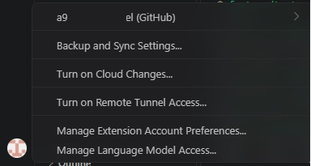

<div align="center">

# 🖥️ 개발 환경 세팅 미션

**터미널 · Docker · Git/GitHub 를 직접 세팅하며 기록한 개발 워크스테이션 구축기**


[](https://github.com/a94496230-pixel/Codyssey)

</div>

---

## 📌 미션 개요
> 터미널, Docker, Git, GitHub를 직접 실습하고
> 개발 환경 구축의 전 과정을 명령어·출력·스크린샷으로 기록한 미션입니다.

---

## 💻 실행 환경

| 항목 | 내용 |
|:---:|:---|
| **OS** | Windows 10, Windows 11 |
| **쉘/터미널** | WSL/Linux, Git Bash (VS Code 내장) |
| **Git 버전** | 2.53.0 |
| **Docker 버전** | Docker version 29.9.3 |

---

## 📂 프로젝트 구조

```text
Codyssey/
├── README.md              # 미션 수행 기술 문서 (전체 기록)
├── Hello.txt              # 터미널 실습용 테스트 파일
├── compose-basic/         # compose 선택 미션 실습 공간
├── docker-practice/       # docker 명령어 실습 공간
├── mynginx/               # 커스텀 NGINX 이미지 소스
│   ├── Dockerfile         #   이미지 설계도
│   └── index.html         #   컨테이너에 띄울 웹 페이지
├── images/                # README 첨부용 스크린샷 모음
├── practice/              # 터미널 명령어 실습 공간
└── 권한연습/              # 파일 권한(chmod) 실습 전용 디렉토리
```

> **설계 기준**: 실습 목적별로 폴더를 분리했습니다.
> - `mynginx/`는 **빌드 소스**(Dockerfile + 콘텐츠)만 모아 재현성을 높였고,
> - `images/`는 **증거 자료**를 코드와 분리해 문서 가독성을 확보했으며,
> - `권한연습/`·`practice/`는 **실습 성격별로 격리**해 루트가 지저분해지지 않도록함.

---


## ✅ 수행 항목 체크리스트

### 1. 터미널 조작 [🖱️검증 및 결과](#1-터미널-조작)
- [x] 현재 위치 확인 (`pwd`)
- [x] 목록 확인 숨김 파일 포함 (`ls -a`)
- [x] 디렉토리 이동 (`cd`)
- [x] 디렉토리/파일 생성 (`mkdir`, `touch`)
- [x] 파일 내용 확인 (`cat`)
- [x] 파일 복사 (`cp`)
- [x] 파일 이동/이름변경 (`mv`)
- [x] 파일 삭제 (`rm`)

### 2. 파일 권한 [🖱️검증 및 결과](#2-파일-권한)
- [x] 권한 확인 (`ls -l`)
- [x] 권한 변경 (`chmod`)

### 3. Docker 설치 및 기본점검 [🖱️검증 및 결과](#3-docker-설치-및-기본점검)
- [x] Docker 버전 확인 (`docker --version`)
- [x] Docker 데몬 동작 확인 (`docker info`)

### 4. Docker 기본 운영 명령 수행 [🖱️검증 및 결과](#4-docker-기본-운영-명령-수행)
- [x] hello-world 컨테이너 실행 (`docker run hello-world`)
- [x] 이미지 목록 확인 (`docker images`)
- [x] 실행 중 컨테이너 확인 (`docker ps`)
- [x] 전체 컨테이너 확인 (`docker ps -a`)
- [x] 컨테이너 로그 확인 (`docker logs`)
- [x] 컨테이너 리소스 확인 (`docker stats`)

### 5. Ubuntu 컨테이너 실습 [🖱️검증 및 결과](#5-ubuntu-컨테이너-실습)
- [x] Ubuntu 컨테이너 실행 (`docker run -it ubuntu bash`)
- [x] 컨테이너 내부에서 간단 명령 수행 (`ls`, `echo`, `exit`)
- [x] 실행 중 컨테이너에 접속 (`docker exec -it`)
- [x] 백그라운드 컨테이너 실행 (`docker run -dit`)
- [x] 이름 붙여 실행 (`docker run --name`)
- [x] "attach"와 "exec" 차이 간단 정리

### 6. 컨테이너 관리 (중지 / 재시작 / 삭제) [🖱️검증 및 결과](#6-컨테이너-관리-중지--재시작--삭제)
- [x] 컨테이너 중지 (`docker stop`)
- [x] 컨테이너 재시작 (`docker start`)
- [x] 컨테이너 삭제 (`docker rm`)
- [x] 이미지 삭제 (`docker rmi`)
> 💡 **stop ↔ start**, **rm ↔ rmi** 짝으로 기억하기

### 7. Dockerfile / 커스텀 이미지 / 포트 매핑 [🖱️검증 및 결과](#7-dockerfile--커스텀-이미지)
- [x] Dockerfile 작성
- [x] 커스텀 이미지 빌드 (`docker build`)
- [x] 컨테이너, 포트 매핑 실행 (`docker run`, `-p 8080:80`)
- [x] 이미지 층(layer) 확인 (`docker history`)


### 8. 볼륨 / 바인드 마운트 [🖱️검증 및 결과](#8-볼륨--바인드-마운트)
- [x] 볼륨 생성/연결/검증 (`docker volume`)
- [x] 컨테이너 삭제 전/후 데이터 유지 확인
- [x] 바인드 마운트 실행 + 호스트 변경 전/후 비교


### 9. Git / GitHub [🖱️검증 및 결과](#9-git--github)
- [x] Git 설치 확인
- [x] 사용자 정보 등록
- [x] 레포지토리 클론
- [x] add / commit / push
- [x] branch 생성 및 관리
- [x] VSCode ↔ GitHub 연동 증거

---

## 🔍 검증 방법 및 결과

---

### **🐧 PART 1. 터미널 & 권한**

### 1. 터미널 조작
> 🖥️ 수행 환경: Git Bash (Windows, VS Code 내장)
<details>
<summary> 검증 내용  </summary>

1. 현재 위치 확인 (`pwd`)

```bash
$ pwd
/c/Codyssey-Campus/codyssey
```


2. 목록 확인 숨김 파일 포함 (`ls -a`)
```bash
$ ls -a
./  ../  .git/  Hello.txt  practice/  README.md
```

3. 디렉토리 이동 (`cd`)
```bash
$ cd .. # .. 은 상위폴더로 이동
```
```bash
$ pwd 
/c/Codyssey-Campus/
```
```bash
$ cd - # - 는 이전 위치로 되돌아가기
/c/Codyssey-Campus/codyssey
```

4. 디렉토리/파일 생성 (`mkdir`, `touch`)
```bash
$ mkdir TEST # TEST 폴더 생성
$ touch TEST.txt # TEST.txt 파일 생성
```
```bash
$ ls -a
./  ../  .git/  Hello.txt  practice/  README.md  TEST/  TEST.txt
```

5. 파일 내용 확인 (`cat`)
```bash 
$ echo "TEST" > TEST.txt # echo명령어로 TEST.txt 파일에 "TEST"입력
```
```bash
$ cat TEST.txt # 입력한 "TEST" 내용 확인
TEST
```

6. 파일 복사 (`cp`)
```bash
$ cp TEST.txt TEST-사본.txt 
```
```bash
$ ls -a
./  ../  .git/  Hello.txt  practice/  README.md  TEST/  TEST.txt  TEST-사본.txt
```

7. 파일 이동/이름변경 (`mv`)
```bash
$ mv TEST-사본.txt TEST-변경.txt # 사본을 변경으로 파일 이름 변경
```
```bash
$ mv TEST-변경.txt TEST/ # 변경 파일을 TEST 폴더로 이동
```
```bash
$ ls -a # 변경 파일이 TEST파일로 이동되었는지 확인1
./  ../  .git/  Hello.txt  practice/  README.md  TEST/  TEST.txt
```
```bash
$ cd TEST
```
```bash
$ pwd
/c/Codyssey-Campus/codyssey/TEST
```
```bash
$ ls -a # 변경 파일이 TEST파일로 이동되었는지 확인2
./  ../  TEST-변경.txt
```

8. 파일 삭제 (`rm`)
```bash
$ rm -r TEST TEST.txt # -r은 디렉토리를 삭제하기 위한 명령어. 파일은 -r 없이도 삭제 가능
```
```bash
$ ls -a
./  ../  .git/  Hello.txt  practice/  README.md
```
</details>


### 2. 파일 권한
> 🐧 수행 환경: WSL/Linux
> 💡 Git Bash(Windows)에서는 chmod가 실제 파일시스템에 정확히 반영되지 않아,
> 권한 실습은 WSL 환경에서 수행했습니다. (→ 트러블슈팅 참고) [🖱️참고](#1-git-bash에서-chmod가-반영되지-않음)

<details>
<summary> 검증 내용  </summary>

1. 권한 확인 (`ls -l`)
```bash
$ pwd # 현재 위치 확인
/home/xoalsrla226230/Codyssey-Campus/Codyssey/권한연습
```
```bash
$ ls -l # -l이 권한을 확인하는 명령어(권한은 소유자,그룹,나머지 순서로 표시)
total 4
drwxr-xr-x 2 xoalsrla226230 xoalsrla226230 4096 Nov  3 14:05 권한연습-하위 # d는 디렉토리 r읽기 w쓰기 x실행
-rw-r--r-- 1 xoalsrla226230 xoalsrla226230    0 Nov  3 14:05 권한연습.txt # 초기 권한 644 상태
```

2. 권한 변경 (`chmod`) 
> 권한 숫자는 `소유자(owner) / 그룹(group) / 기타 사용자(others)` 순서로 표시됩니다.  
> 각 숫자는 `읽기 r = 4`, `쓰기 w = 2`, `실행 x = 1`을 더해서 계산합니다.
```bash
$ chmod 744 권한연습.txt # 소유자 실행권한 추가 rw-(6)에서 rwx(7)로 변경 (4+2+1=7)
$ ls -l # 권한 확인
total 4
drwxr-xr-x 2 xoalsrla226230 xoalsrla226230 4096 Nov  3 14:05 권한연습-하위
-rwxr--r-- 1 xoalsrla226230 xoalsrla226230    0 Nov  3 14:05 권한연습.txt # rw-가 rwx로 변경됨
```
```bash
$ chmod 764 권한연습.txt # 그룹에 쓰기권한 추가 r--(4)에서 rw-(6)으로 변경 (4+2=6)
$ ls -l
total 4
drwxr-xr-x 2 xoalsrla226230 xoalsrla226230 4096 Nov  3 14:05 권한연습-하위
-rwxrw-r-- 1 xoalsrla226230 xoalsrla226230    0 Nov  3 14:05 권한연습.txt # r--였던 그룹권한이 rw-로 변경
```
```bash
$ chmod 777 권한연습.txt # 모든 사용자에게 모든 권한 부여. 7(4+2+1=7)
$ ls -l
total 4
drwxr-xr-x 2 xoalsrla226230 xoalsrla226230 4096 Nov  3 14:05 권한연습-하위
-rwxrwxrwx 1 xoalsrla226230 xoalsrla226230    0 Nov  3 14:05 권한연습.txt # 모두 rwx상태
```
```bash
$ chmod 770 권한연습.txt # 나와 그룹을 제외한 모든 권한 제거 0(권한 없음)
$ ls -l
total 4
drwxr-xr-x 2 xoalsrla226230 xoalsrla226230 4096 Nov  3 14:05 권한연습-하위
-rwxrwx--- 1 xoalsrla226230 xoalsrla226230    0 Nov  3 14:05 권한연습.txt # 기타 사용자 ---상태
```
```bash
$ chmod 644 권한연습.txt # 초기 권한상태로 복구
$ ls -l
total 4
drwxr-xr-x 2 xoalsrla226230 xoalsrla226230 4096 Nov  3 14:05 권한연습-하위
-rw-r--r-- 1 xoalsrla226230 xoalsrla226230    0 Nov  3 14:05 권한연습.txt # 초기 644로 복구
```
```bash
$ chmod 700 권한연습-하위 # 755(초기권한)→700, 그룹·기타 권한 전체 제거 (비밀 폴더)
$ ls -l
total 4
drwx------ 2 xoalsrla226230 xoalsrla226230 4096 Nov  3 14:05 권한연습-하위
-rw-r--r-- 1 xoalsrla226230 xoalsrla226230    0 Nov  3 14:05 권한연습.txt
```

</details>

---

### **🐳 PART 2. Docker**

### 3. Docker 설치 및 기본점검
<details>
<summary> 검증 내용  </summary>

1. Docker 버전 확인 (`docker --version`)
```bash
$ docker --version
Docker version 29.9.3, build 5457199
```

2. Docker 데몬 동작 확인 (`docker info`)
```bash
$ docker info
Client: Docker Engine - Community # docker의 명령을 입력하는 클라이언트(CLI) 정보
 Version:    29.9.3
 Context:    default
 Debug Mode: false
 Plugins:
  buildx: Docker Buildx (Docker Inc.)
    Version:  v0.38.1
    Path:     /usr/libexec/docker/cli-plugins/docker-buildx
  compose: Docker Compose (Docker Inc.)
    Version:  v5.7.0
    Path:     /usr/libexec/docker/cli-plugins/docker-compose

Server: # 실제 컨테이너를 돌리는 daemon의 정보
 Containers: 0
  Running: 0
  Paused: 0
  Stopped: 0
 Images: 0
 Server Version: 29.9.3
 Storage Driver: overlayfs
  driver-type: io.containerd.snapshotter.v1
 Logging Driver: json-file
 Cgroup Driver: systemd
 Cgroup Version: 2
 Plugins:
  Volume: local
  Network: bridge host ipvlan macvlan null overlay
  Log: awslogs fluentd gcplogs gelf journald json-file local splunk syslog
 CDI spec directories:
  /etc/cdi
  /var/run/cdi
 Swarm: inactive
 Runtimes: io.containerd.runc.v2 runc
 Default Runtime: runc
 Init Binary: docker-init
 containerd version: b7a25261e029d68978bbf290df0a62fc819b3c51
 runc version: v1.5.2-0-g29dd3dc2
 init version: de40ad0
 Security Options:
  seccomp
   Profile: builtin
  cgroupns
 Kernel Version: 6.18.54.1-microsoft-standard-WSL2
 Operating System: Ubuntu 22.04.5 LTS
 OSType: linux
 Architecture: x86_64
 CPUs: 24
 Total Memory: 15.25GiB
 Name: GNIA-C202-A04
 ID: fd6bc33e-cf90-4269-a8dd-4a38cf4860e9
 Docker Root Dir: /var/lib/docker
 Debug Mode: false
 Experimental: false
 Insecure Registries:
  127.0.0.0/8
  ::1/128
 Live Restore Enabled: false
 Firewall Backend: iptables
  EnableUserlandProxy: true
  UserlandProxyPath: /usr/bin/docker-proxy
```
</details>

### 4. Docker 기본 운영 명령 수행
<details>
<summary> 검증 내용  </summary>

1. hello-world 컨테이너 실행 (`docker run hello-world`)
```bash
$ docker run hello-world
Unable to find image 'hello-world:latest' locally # local에서 hello-world를 찾을 수 없음
latest: Pulling from library/hello-world # 인터넷에서 가져옴
4f55086f7dd0: Pull complete 
d5e71e642bf5: Download complete 
Digest: sha256:c567b231f65614688711a75f31518a064258a51d442117a3e771a3a8fdba78ef
Status: Downloaded newer image for hello-world:latest

Hello from Docker! # 결과
This message shows that your installation appears to be working correctly.

To generate this message, Docker took the following steps: # 과정 메시지
 1. The Docker client contacted the Docker daemon. # CLI가 daemon(server)에게 요청
 2. The Docker daemon pulled the "hello-world" image from the Docker Hub.
    (amd64)
 3. The Docker daemon created a new container from that image which runs the
    executable that produces the output you are currently reading.
 4. The Docker daemon streamed that output to the Docker client, which sent it
    to your terminal. # daemon이 CLI에게 결과를 돌려줌

To try something more ambitious, you can run an Ubuntu container with:
 $ docker run -it ubuntu bash

Share images, automate workflows, and more with a free Docker ID:
 https://hub.docker.com/

For more examples and ideas, visit:
 https://docs.docker.com/get-started/
 ```
> 입문 교육용 이미지인 hello-world에서 여러 안내 메시지가 출력됨.


2. 이미지 목록 확인 (`docker images`)
```bash
$ docker images
                                                                                                     i Info →   U  In Use
IMAGE                ID             DISK USAGE   CONTENT SIZE   EXTRA
hello-world:latest   c567b231f656       25.9kB         9.49kB    U   
```
> 이름 : 뒤는 태그. 지정하지 않으면 자동으로 latest, ID는 고유식별ID, U는 in use 사용 중.

3. 실행 중 컨테이너 확인 (`docker ps`)
```bash
$ docker ps # 실행중인 컨테이너 없음
CONTAINER ID   IMAGE     COMMAND   CREATED   STATUS    PORTS     NAMES
```

4. 전체 컨테이너 확인 (`docker ps -a`)
```bash
$ docker ps -a
CONTAINER ID   IMAGE         COMMAND    CREATED          STATUS                      PORTS     NAMES
61344da3d406   hello-world   "/hello"   21 minutes ago   Exited (0) 21 minutes ago             laughing_driscoll
```
> 이미지와 컨테이너 분리해서 알아야함. 이미지는 In Use 상태, 컨테이너는 Exited(0)되어 running이 아니기 때문에 ps에는 보이지 않고 ps -a로 확인 가능.
> 사용 중, 실행 중의 구분이 모호했으나 이미지와 컨테이너의 차이였음.
> hello-world는 docker가 제대로 설치되고 작동되는 지 확인하는 테스트용 이미지이기 때문에 임의로 exit하지 않아도 "Hello from Docker!"라는 메시지 출력 후 자동으로 종료됨. 그래서 내가 끄지 않았는데도 ps로 확인 할 수 없었음.

5. 컨테이너 로그 확인 (`docker logs`)
```bash
$ docker logs 61344 # 컨테이너의 고유ID 앞부분 만으로 출력가능. 이전에 출력됐던 log가 출력됨.

Hello from Docker!
This message shows that your installation appears to be working correctly.

To generate this message, Docker took the following steps:
 1. The Docker client contacted the Docker daemon.
 2. The Docker daemon pulled the "hello-world" image from the Docker Hub.
    (amd64)
 3. The Docker daemon created a new container from that image which runs the
    executable that produces the output you are currently reading.
 4. The Docker daemon streamed that output to the Docker client, which sent it
    to your terminal.

To try something more ambitious, you can run an Ubuntu container with: # Ubuntu 컨테이너 추천. 교육용이라 출력되는 듯
 $ docker run -it ubuntu bash

Share images, automate workflows, and more with a free Docker ID:
 https://hub.docker.com/

For more examples and ideas, visit:
 https://docs.docker.com/get-started/
 ```

6. 컨테이너 리소스 확인 (`docker stats`)
```bash
$ docker ps # 리소스 확인 전 ps로 현재 실행중인 컨테이너 확인
CONTAINER ID   IMAGE     COMMAND       CREATED          STATUS          PORTS     NAMES
636354721ff5   ubuntu    "/bin/bash"   15 minutes ago   Up 15 minutes             naughty_hoover
835f8e82e7a4   ubuntu    "/bin/bash"   27 minutes ago   Up 19 minutes             focused_lumiere
```
```bash
$ docker stats # 결과값
CONTAINER ID   NAME              CPU %     MEM USAGE / LIMIT     MEM %     NET I/O         BLOCK I/O   PIDS
636354721ff5   naughty_hoover    0.00%     1.125MiB / 15.25GiB   0.01%     1.05kB / 126B   0B / 0B     1
835f8e82e7a4   focused_lumiere   0.00%     948KiB / 15.25GiB     0.01%     1.46kB / 126B   0B / 0B     1
```
</details>

### 5. Ubuntu 컨테이너 실습
<details>
<summary> 검증 내용  </summary>

1. Ubuntu 컨테이너 실행 (`docker run -it ubuntu bash`)
```bash
$ docker run -it ubuntu bash
Unable to find image 'ubuntu:latest' locally # hello-world와 마찬가지로 local에 없어서 인터넷에서 다운로드.
latest: Pulling from library/ubuntu
f3f25b84a7d7: Pull complete 
edafa32f5d9e: Pull complete 
21594acc2d8b: Download complete 
Digest: sha256:6a06111c3b0a8600feadb270aec771dc239bf407b25625f93f44ab00e11f4d3c
Status: Downloaded newer image for ubuntu:latest
root@79389cf69868:/#
```

2. 컨테이너 내부에서 간단 명령 수행 (`ls`, `echo`, `exit`)
```bash
ls
bin  boot  dev  etc  home  lib  lib64  media  mnt  opt  proc  root  run  sbin  srv  sys  tmp  usr  var
```
```bash
/# mkdir study # study 폴더 생성
/# ls # 생성 확인
bin  boot  dev  etc  home  lib  lib64  media  mnt  opt  proc  root  run  sbin  srv  study  sys  tmp  usr  var
/# cd study # study 폴더로 이동
/study# pwd # 현재 위치
/study
/study# touch memo.txt # memo.txt 생성
/study# ls # 생성 확인
memo.txt
/study# echo "Docker study" > memo.txt # Docker study라는 내용 memo.txt에 입력
/study# cat memo.txt
Docker study # 입력된 내용 확인
```
```bash 
/study# exit # Ubuntu 컨테이너 종료
exit
$ docker ps -a # 컨테이너에서 나와 내 컴퓨터로 프롬프트가 바뀐 상태에서 컨테이너 확인 명령(docker ps -a)
CONTAINER ID   IMAGE         COMMAND    CREATED             STATUS                           PORTS     NAMES
138cba0d7b9e   ubuntu        "bash"     32 minutes ago      Exited (0) 6 seconds ago                   optimistic_mcnulty
79389cf69868   ubuntu        "bash"     About an hour ago   Exited (127) About an hour ago             eager_kepler
61344da3d406   hello-world   "/hello"   2 hours ago         Exited (0) 2 hours ago                     laughing_driscoll
```
> 6초 전에 종료된 ubuntu 컨테이너가 방금 exit한 컨테이너.

3. 실행 중 컨테이너에 접속 (`docker exec -it`)
```bash
$ docker start 138cba0d7b9e # 컨테이너 실행
138cba0d7b9e
```
```bash
$ docker exec -it 138cba0d7b9e bash 
root@138cba0d7b9e:/# # 접속 확인
```

4. 백그라운드 컨테이너 실행 (`docker run -dit`)
```bash
$ docker run -dit ubuntu # 기존 실행했던 -it에 -d가 추가됨. -d(detached):백그라운드 실행, -i(interactive):입력, -t(tty):터미널 화면
636354721ff5c5358e374016aaafafadf6a534f4f279b7563cdca7a0b82a1319
```
```bash
$ docker ps
CONTAINER ID   IMAGE     COMMAND       CREATED          STATUS          PORTS     NAMES
636354721ff5   ubuntu    "/bin/bash"   11 seconds ago   Up 11 seconds             naughty_hoover # 백그라운드로 실행한 컨테이너
835f8e82e7a4   ubuntu    "/bin/bash"   12 minutes ago   Up 4 minutes              focused_lumiere
```

5. 이름 붙여 실행 (`docker run --name`)
```bash
$ docker run --name TEST ubuntu # TEST라는 이름을 가진 컨테이너를 ubuntu이미지로 실행함
```
```bash
$ docker ps -a # 실행했지만 -it나 -dit 가 포함되지 않아 실행 후 바로 Exited 된 상태.
CONTAINER ID   IMAGE         COMMAND       CREATED          STATUS                        PORTS     NAMES
35621fb2791e   ubuntu        "/bin/bash"   8 seconds ago    Exited (0) 7 seconds ago                TEST
636354721ff5   ubuntu        "/bin/bash"   10 minutes ago   Up 10 minutes                           naughty_hoover
835f8e82e7a4   ubuntu        "/bin/bash"   22 minutes ago   Up 15 minutes                           focused_lumiere
138cba0d7b9e   ubuntu        "bash"        2 hours ago      Exited (137) 20 minutes ago             optimistic_mcnulty
79389cf69868   ubuntu        "bash"        3 hours ago      Exited (127) 3 hours ago                eager_kepler
61344da3d406   hello-world   "/hello"      4 hours ago      Exited (0) 4 hours ago                  laughing_driscoll
```

6. "attach"와 "exec" 차이 간단 정리
```bash
$ docker exec -it 835f8e82e7a4 bash # exec 으로 835..컨테이너 실행. 이후 exit
root@835f8e82e7a4:/# exit
exit
```
```bash
$ docker ps # exit를 하더라도 STATUS가 UP 상태임을 확인.
CONTAINER ID   IMAGE     COMMAND       CREATED             STATUS          PORTS     NAMES
835f8e82e7a4   ubuntu    "/bin/bash"   About an hour ago   Up 58 minutes             focused_lumiere
```
```bash
$ docker attach 835f8e82e7a4 # attach를 사용해 동일 컨테이너 실행. 이후 exit
root@835f8e82e7a4:/# exit
exit
```
```bash
$ docker ps -a # Exited 상태 확인 
CONTAINER ID   IMAGE     COMMAND       CREATED             STATUS                           PORTS     NAMES
636354721ff5   ubuntu    "/bin/bash"   56 minutes ago      Exited (137) 38 minutes ago                naughty_hoover
835f8e82e7a4   ubuntu    "/bin/bash"   About an hour ago   Exited (0) About a minute ago              focused_lumiere
138cba0d7b9e   ubuntu    "bash"        3 hours ago         Exited (137) About an hour ago             optimistic_mcnulty
79389cf69868   ubuntu    "bash"        4 hours ago         Exited (127) 4 hours ago                   eager_kepler
```
> attach : 컨테이너의 "메인 프로세스"에 직접 연결. exit하면 컨테이너도 종료됨.
> exec   : 컨테이너 안에서 "새 프로세스"를 실행. exit해도 컨테이너는 계속 실행됨.
> 실행 중인 컨테이너에 들어갈 땐 `docker exec -it`를 사용 하는 것이 안전할 듯함.
> ps. attach 중 Ctrl+P → Ctrl+Q 를 누르면, 컨테이너를 끄지 않고 빠져나올 수 있음(detach).
</details>

### 6. 컨테이너 관리 (중지 / 재시작 / 삭제)
<details>
<summary> 검증 내용  </summary>

1. 컨테이너 중지(`docker stop`)
```bash 
$ docker stop 138cba0d7b9e
138cba0d7b9e
```
```bash
$ docker ps -a # `ps -a`로 컨테이너 상태 확인. STATUS Exited 확인.
CONTAINER ID   IMAGE         COMMAND       CREATED         STATUS                        PORTS     NAMES
835f8e82e7a4   ubuntu        "/bin/bash"   3 minutes ago   Exited (137) 35 seconds ago             focused_lumiere
138cba0d7b9e   ubuntu        "bash"        2 hours ago     Exited (137) 14 seconds ago             optimistic_mcnulty
79389cf69868   ubuntu        "bash"        3 hours ago     Exited (127) 2 hours ago                eager_kepler
```

2. 컨테이너 재시작 (`docker start`)
```bash
$ docker start 835f8e82e7a4
835f8e82e7a4
```
```bash
$ docker ps # 'ps'로 확인. STATUS UP 확인.
CONTAINER ID   IMAGE     COMMAND       CREATED         STATUS         PORTS     NAMES
835f8e82e7a4   ubuntu    "/bin/bash"   7 minutes ago   Up 7 seconds             focused_lumiere
```

3. 컨테이너 삭제 (`docker rm`)
```bash
$ docker ps -a # 삭제 전 전체 컨테이너 확인
CONTAINER ID   IMAGE         COMMAND       CREATED          STATUS                        PORTS     NAMES
35621fb2791e   ubuntu        "/bin/bash"   8 minutes ago    Exited (0) 8 minutes ago                TEST
636354721ff5   ubuntu        "/bin/bash"   18 minutes ago   Exited (137) 19 seconds ago             naughty_hoover
835f8e82e7a4   ubuntu        "/bin/bash"   31 minutes ago   Up 23 minutes                           focused_lumiere
138cba0d7b9e   ubuntu        "bash"        2 hours ago      Exited (137) 28 minutes ago             optimistic_mcnulty
79389cf69868   ubuntu        "bash"        3 hours ago      Exited (127) 3 hours ago                eager_kepler
61344da3d406   hello-world   "/hello"      4 hours ago      Exited (0) 4 hours ago                  laughing_driscoll
```
```bash
$ docker rm 35621fb2791e # ID가 35621fb2791e인 TEST이름의 컨테이너 삭제 명령
35621fb2791e
```
```bash
$ docker ps -a # 삭제된게 확인됨.
CONTAINER ID   IMAGE         COMMAND       CREATED          STATUS                            PORTS     NAMES
636354721ff5   ubuntu        "/bin/bash"   19 minutes ago   Exited (137) About a minute ago             naughty_hoover
835f8e82e7a4   ubuntu        "/bin/bash"   32 minutes ago   Up 24 minutes                               focused_lumiere
138cba0d7b9e   ubuntu        "bash"        2 hours ago      Exited (137) 29 minutes ago                 optimistic_mcnulty
79389cf69868   ubuntu        "bash"        3 hours ago      Exited (127) 3 hours ago                    eager_kepler
61344da3d406   hello-world   "/hello"      4 hours ago      Exited (0) 4 hours ago                      laughing_driscoll
```

4. 이미지 삭제 (`docker rmi`)
```bash
$ docker images
                                                                                                                                                                          i Info →   U  In Use
IMAGE                ID             DISK USAGE   CONTENT SIZE   EXTRA
hello-world:latest   c567b231f656       25.9kB         9.49kB    U   
ubuntu:latest        6a06111c3b0a        163MB         45.9MB    U   
```
```bash
$ docker rmi c567b231f656
Error response from daemon: conflict: unable to delete c567b231f656 (must be forced) - image is being used by stopped container 61344da3d406
```
> 삭제가 되지 않음. 트러블슈팅 참고.[🖱️참고](#2-docker에서-image를-삭제하려고-했으나-오류-발생)
```bash
$ docker ps -a # 삭제하려던 이미지인 헬로월드 컨테이너 확인
CONTAINER ID   IMAGE         COMMAND       CREATED          STATUS                            PORTS     NAMES
636354721ff5   ubuntu        "/bin/bash"   19 minutes ago   Exited (137) About a minute ago             naughty_hoover
835f8e82e7a4   ubuntu        "/bin/bash"   32 minutes ago   Up 24 minutes                               focused_lumiere
138cba0d7b9e   ubuntu        "bash"        2 hours ago      Exited (137) 29 minutes ago                 optimistic_mcnulty
79389cf69868   ubuntu        "bash"        3 hours ago      Exited (127) 3 hours ago                    eager_kepler
61344da3d406   hello-world   "/hello"      4 hours ago      Exited (0) 4 hours ago                      laughing_driscoll
```
```bash
$ docker rm 61344da3d406 # 헬로월드 컨테이너 삭제
61344da3d406
```
```bash
$ docker rmi c567b231f656 # 헬로월드 이미지 삭제
Untagged: hello-world:latest
Deleted: sha256:c567b231f65614688711a75f31518a064258a51d442117a3e771a3a8fdba78ef
```
```bash
$ docker images # 헬로월드 이미지 삭제 확인
                                                                                                                                                                          i Info →   U  In Use
IMAGE           ID             DISK USAGE   CONTENT SIZE   EXTRA
ubuntu:latest   6a06111c3b0a        163MB         45.9MB    U   
```
</details>

### 7. Dockerfile / 커스텀 이미지
<details>
<summary> 검증 내용  </summary>

1. Dockerfile 작성
> 앞으로 진행할 이미지 만들기 → 웹페이지 띄우기 → 브라우저 접속 → 데이터 유지(볼륨, 바인드)가 매끄럽게 이어지며 학습하는 데 nginx가 유리하다고 생각되어 선택함.
```bash
$ mkdir mynginx # mynginx 폴더 생성
$ cd mynginx
/mynginx$ touch index.html Dockerfile # 웹페이지 파일과 Dockerfile 생성
/mynginx$ ls 
Dockerfile  index.html
```

`index.html` — 웹에 띄울 내용 작성 [🖱️트러블슈팅](#3-웹페이지-한글-깨짐-현상)
```html
<!DOCTYPE html>
<html>
<head>
    <meta charset="UTF-8"> <!-- 한글 깨짐 방지를 위한 UTF-8 인코딩 트러블슈팅 참고 -->
    <title>나의 첫 NGINX</title>
</head>
<body>
    <h1>Hello Docker NGINX!</h1>
    <p>내가 만든 커스텀 이미지에서 나오는 페이지예요.</p>
</body>
</html>
```

`Dockerfile` - 이미지 설계도 작성
```Dockerfile
FROM nginx:latest 
# nginx 공식 이미지를 베이스로 사용.
COPY index.html /usr/share/nginx/html/index.html 
# 내가 만든 index.html을 nginx 기본 경로에 복사.
```
> 💡 nginx는 `/usr/share/nginx/html/`을 기본 웹페이지 경로로 사용함.
> **커스텀 포인트 요약**
> | 베이스 이미지 | 커스텀 내용 | 목적 |
> |---|---|---|
> | `nginx:latest` | `index.html` 교체(COPY) | 기본 페이지 대신 내 페이지를 노출 |
> | `index.html` | `<meta charset="UTF-8">` 추가 | 한글 깨짐 방지 |

2. 커스텀 이미지 빌드 (`docker build`)
```bash
/mynginx$ docker build -t mynginx:1.0 . # -t:이미지 이름(태그) 지정, . 은 현재 폴더의 Dockerfile 사용
[+] Building 14.8s (7/7) FINISHED
```
```bash
/mynginx$ docker images mynginx # mynginx 이름의 이미지 상태 확인
IMAGE         ID             DISK USAGE   CONTENT SIZE   EXTRA
mynginx:1.0   ad6f4a74ea94        241MB         63.9MB        
```

3. 컨테이너 + 포트 매핑 실행 (`docker run`, `-p 8080:80`)
```bash
$ docker run -d -p 8080:80 --name web mynginx:1.0
9182e05b90d912e5935f83a13902175577b7b304fa0cf11b7c392345a3d87d70
```
> `-p`포트설정, 8080은 내가 접속할 포트, 80은 nginx가 쓰는 고정포트. 콜론(:)으로 나뉨.

```bash
 docker ps
CONTAINER ID   IMAGE         COMMAND                   CREATED         STATUS         PORTS                                     NAMES
9182e05b90d9   mynginx:1.0   "/docker-entrypoint.…"   5 minutes ago   Up 5 minutes   0.0.0.0:8080->80/tcp, [::]:8080->80/tcp   web
```

4. 웹페이지 확인


> 브라우저에서 `localhost:8080` 접속


5. 이미지 층(layer) 확인 (`docker history`)
```bash
/mynginx$ docker history mynginx:1.0 #
IMAGE          CREATED       CREATED BY                                       SIZE      COMMENT
428eb5a0ff8b   3 hours ago   COPY index.html /usr/share/nginx/html/index.…   24.6kB    buildkit.dockerfile.v0
<missing>      8 days ago    CMD ["nginx" "-g" "daemon off;"]                 0B        buildkit.dockerfile.v0
<missing>      8 days ago    STOPSIGNAL SIGQUIT                               0B        buildkit.dockerfile.v0
<missing>      8 days ago    EXPOSE map[80/tcp:{}]                            0B        buildkit.dockerfile.v0
<missing>      8 days ago    ENTRYPOINT ["/docker-entrypoint.sh"]             0B        buildkit.dockerfile.v0
<missing>      8 days ago    COPY 30-tune-worker-processes.sh /docker-ent…   16.4kB    buildkit.dockerfile.v0
<missing>      8 days ago    COPY 20-envsubst-on-templates.sh /docker-ent…   12.3kB    buildkit.dockerfile.v0
<missing>      8 days ago    COPY 15-local-resolvers.envsh /docker-entryp…   12.3kB    buildkit.dockerfile.v0
<missing>      8 days ago    COPY 10-listen-on-ipv6-by-default.sh /docker…   12.3kB    buildkit.dockerfile.v0
<missing>      8 days ago    COPY docker-entrypoint.sh / # buildkit           8.19kB    buildkit.dockerfile.v0
<missing>      8 days ago    RUN /bin/sh -c set -x     && groupadd --syst…   88.8MB    buildkit.dockerfile.v0
<missing>      8 days ago    ENV DYNPKG_RELEASE=1~trixie                      0B        buildkit.dockerfile.v0
<missing>      8 days ago    ENV PKG_RELEASE=1~trixie                         0B        buildkit.dockerfile.v0
<missing>      8 days ago    ENV ACME_VERSION=0.4.1                           0B        buildkit.dockerfile.v0
<missing>      8 days ago    ENV NJS_RELEASE=1~trixie                         0B        buildkit.dockerfile.v0
<missing>      8 days ago    ENV NJS_VERSION=1.0.2                            0B        buildkit.dockerfile.v0
<missing>      8 days ago    ENV NGINX_VERSION=1.31.8                         0B        buildkit.dockerfile.v0
<missing>      8 days ago    LABEL maintainer=NGINX Docker Maintainers <d…   0B        buildkit.dockerfile.v0
<missing>      9 days ago    # debian.sh --arch 'amd64' out/ 'trixie' '@1…   87.7MB    debuerreotype 0.17
```
> missing은 에러가 아니라 공식 nginx이미지를 받아올 때 ID정보가 없어서 표시되는 것.
> 맨 위의 한 줄이 내가 만든 부분. Dockerfile을 작성한 내용이 들어있다.
</details>


### 8. 볼륨 / 바인드 마운트
<details>
<summary> 검증 내용  </summary>

1. 볼륨 생성 및 확인
```bash
/mynginx$ docker volume create myvolume # myvolume 이름의 볼륨 생성.
myvolume
/mynginx$ docker volume ls # myvolume 생성 확인
DRIVER    VOLUME NAME
local     myvolume
```

2. 볼륨 연결 및 컨테이너 실행
```bash
/mynginx$ docker run -d --name volume-test -v myvolume:/data nginx
```
> `-d`백그라운드, `--name`이름지정, `-v`연결 myvolume과 컨테이너의 /data폴더를 연결한 `nginx`기반 컨테이너 실행

3. 볼륨 데이터 영속성 테스트
```bash
/mynginx$ docker exec -it volume-test bash # 컨테이너 실행
/# cd data # 볼륨과 연결된 컨테이너 data 폴더로 이동
/data# touch testfile # testfile 생성
/data# exit
```
```bash
/mynginx$ docker ps -a # volume-test 컨테이너 확인
CONTAINER ID   IMAGE         COMMAND                   CREATED          STATUS                    PORTS                                     NAMES
5c49191b4cb6   nginx         "/docker-entrypoint.…"   7 minutes ago    Up 7 minutes              80/tcp                                    volume-test
d682884b6160   mynginx:1.0   "/docker-entrypoint.…"   20 minutes ago   Up 20 minutes             0.0.0.0:8080->80/tcp, [::]:8080->80/tcp   web
7862d5b07eba   ubuntu        "bash"                    41 hours ago     Exited (0) 41 hours ago                                             trusting_torvalds
```
```bash
/mynginx$ docker rm -f volume-test # volume-test 컨테이너 삭제
volume-test
/mynginx$ docker ps -a # 삭제 확인
CONTAINER ID   IMAGE         COMMAND                   CREATED          STATUS                    PORTS                                     NAMES
d682884b6160   mynginx:1.0   "/docker-entrypoint.…"   27 minutes ago   Up 27 minutes             0.0.0.0:8080->80/tcp, [::]:8080->80/tcp   web
7862d5b07eba   ubuntu        "bash"                    41 hours ago     Exited (0) 41 hours ago                                             trusting_torvalds
```
```bash
/mynginx$ docker run -d --name volume-test -v myvolume:/data nginx # 볼륨과 연결한 컨테이너 재생성
e92a4192bf014efca8a0611ca243258882ecc68797a51de818ab6babf94290c1
mynginx$ docker exec -it volume-test bash # 컨테이너 실행
/# cd data
/data# ls # 컨테이너를 삭제했어도 testfile이 유지됨을 확인
testfile
```

4. 바인드 마운트
```bash
$ docker run -d --name bind-test -p 8081:80 -v $(pwd):/usr/share/nginx/html nginx
373a49e5e467e0a78ea804d8be92e041fe7de743c625ca177aec9eb192bd4f09
```
> 8080은 Dockerfile생성 실습으로 사용 중. 8081 지정, `$(pwd)`는 현재 경로, 즉 현재 경로와 nginx 기본 웹경로를 연결.
> 볼륨과는 다르게 현재 경로의 index.html을 수정하면 재빌드 없이 바로 브라우저에 반영됨.

5. 바인드 마운트 호스트 index.html 수정 전/후


> index.html에  `<h2>바인드 마운트 실습 성공! ⚡</h2>` 한 줄 추가.


> 새로고침 즉시 반영
</details>

---

### **🔀 PART 3. Git & GitHub**

### 9. Git / GitHub
<details>
<summary> 검증 내용  </summary>

1. Git 설치 확인
```bash
$ git --version
git version 2.53.0
```

2. 사용자 등록 및 정보 확인 (`--list`)
```bash
$ git config --list # 사용자 등록 상태 확인
user.name=a9************el
user.email=a9*******@gmail.com
core.repositoryformatversion=0
core.filemode=true
core.bare=false
core.logallrefupdates=true
remote.origin.url=https://github.com/a9*********el/Codyssey.git
remote.origin.fetch=+refs/heads/*:refs/remotes/origin/*
branch.main.remote=origin
branch.main.merge=refs/heads/main
branch.main.vscode-merge-base=origin/main
```

3. 레포지토리 클론

```bash
$ mkdir CloneTest # 클론을 위한 테스트 폴더 생성
$ cd CloneTest
/CloneTest$ git clone https://github.com/a9********el/Codyssey
Cloning into 'Codyssey'...
remote: Enumerating objects: 58, done.
remote: Counting objects: 100% (58/58), done.
remote: Compressing objects: 100% (36/36), done.
remote: Total 58 (delta 13), reused 55 (delta 10), pack-reused 0 (from 0)
Receiving objects: 100% (58/58), 93.16 KiB | 9.32 MiB/s, done.
Resolving deltas: 100% (13/13), done.
```
```bash
/CloneTest$ ls -a # GitHub 클론 확인
.  ..  Codyssey
/CloneTest/Codyssey$ ls -a
.   .git     Hello.txt  docker-practice  mynginx   권한연습
..  .vscode  README.md  images           practice
```

4. `add` / `commit` / `push`
```bash
$ git add . # . 은 전부 add
$ git commit -m "최신화" # -m 뒤에 따옴표는 정보 입력
$ git push # 업로드 pull은 다운로드
Enumerating objects: 5, done.
Counting objects: 100% (5/5), done.
Delta compression using up to 12 threads
Compressing objects: 100% (3/3), done.
Writing objects: 100% (3/3), 1.29 KiB | 1.29 MiB/s, done.
Total 3 (delta 2), reused 0 (delta 0), pack-reused 0 (from 0)
remote: Resolving deltas: 100% (2/2), completed with 2 local objects.
To https://github.com/a9*********el/Codyssey.git
   421ff78..50ff1ab  main -> main
```

5. branch 생성 및 관리

```bash
$ git branch # 현재 branch 확인
* main
$ git branch feature/test  # 신규 branch 생성
$ git branch # 생성 확인
  feature/test
* main
$ git checkout feature/test # 신규 branch로 이동
Switched to branch 'feature/test'
$  git branch  # 이동된 상태 확인
* feature/test
  main
$ git checkout main # 다시 main branch로 이동
Switched to branch 'main'
Your branch is up to date with 'origin/main'.
$ git branch -d feature/test # 신규 branch 삭제
Deleted branch feature/test (was 50ff1ab).
```

6. VSCode ↔ GitHub 연동
```bash
$ git remote -v
origin  https://github.com/a9********el/Codyssey.git (fetch)
origin  https://github.com/a9********el/Codyssey.git (push)
```


>연동 화면
</details>

---

## 🧩 트러블슈팅
### 1. Git Bash에서 chmod가 반영되지 않음
- **문제**: Git Bash(Windows)에서 `chmod 744`를 실행해도 `ls -l` 권한 표기가 바뀌지 않음
- **원인**: Windows 파일시스템(NTFS)은 리눅스식 rwx 권한 모델을 그대로 지원하지 않음
- **확인**: 동일 명령을 WSL/Linux 환경에서 실행 → 권한이 정상 반영됨
- **해결/대안**: 권한 실습은 WSL 환경에서 수행하기로 결정

### 2. Docker에서 Image를 삭제하려고 했으나 오류 발생
- **문제**: Docker에서 `docker rmi ID`를 실행해도 삭제되지 않음.
- **원인**: 해당 Image로 실행했던 컨테이너가 남아있어서 명령을 수행하지 못함
- **확인**: 컨테이너를 목록을 확인, 삭제를 원하는 이미지의 컨테이너를 삭제 후 다시 Image삭제 시도
- **해결/대안**: *rm ↔ rmi*을 짝을 지어 학습. 컨테이너의 큰 틀을 담당하는 이미지는 만들어진 컨테이너가 있으면 삭제가 되지 않음을 학습.

### 3. 웹페이지 한글 깨짐 현상
- **문제** : 브라우저에서 한글이 깨져 보임.
- **원인** : 1. index.html 인코딩 문제? 2. 브라우저 이전 응답 캐시?
- **확인** : 파일은 UTF-8로 저장됨 → 재빌드 후에도 깨짐 지속.
- **해결** : 브라우저 **강력 새로고침(Ctrl+Shift+R)**으로 캐시 삭제 → 정상 출력.

---

## 📖 개념 정리 

### 1. 절대 경로 vs 상대 경로
- **절대 경로**: 최상위(root)부터의 전체 경로. 현재 위치와 무관하게 항상 같은 곳을 가리킴.
  - 예: `/c/Codyssey-Campus/codyssey/README.md`
- **상대 경로**: 현재 위치를 기준으로 한 경로.
  - 예: 현재 위치가 `codyssey`일 때 `./README.md`, 상위 이동은 `../`

### 2. 파일 권한(r/w/x)과 숫자 표기
- `r(읽기)=4`, `w(쓰기)=2`, `x(실행)=1`, 세 자리는 `소유자/그룹/기타` 순서.
- `644` = `rw-r--r--` : 소유자 읽기·쓰기, 그룹·기타는 읽기만 → 일반 문서 파일 기본값
- `755` = `rwxr-xr-x` : 소유자 전체 권한, 나머지는 읽기·실행 → 디렉토리/실행 파일 기본값

### 3. 포트 매핑이 필요한 이유
- 컨테이너는 호스트와 **격리된 네트워크**를 가져, 외부에서 바로 접근할 수 없음.
- `-p 8080:80`은 호스트 8080 요청을 컨테이너 80으로 **전달(연결)**해 브라우저 접속을 가능하게 함.

### 4. Docker 볼륨(영속 데이터)
- 컨테이너는 삭제되면 내부 데이터도 사라짐(휘발성).
- 볼륨은 데이터를 **컨테이너 외부(Docker 관리 영역)**에 저장해, 컨테이너를 삭제·재생성해도 데이터가 유지됨.
- (본 실습에서 `volume-test` 삭제 후 재생성해도 `testfile`이 남아있음으로 검증)

### 5. Git vs GitHub
- **Git**: 내 컴퓨터(로컬)에서 변경 이력을 관리하는 **버전 관리 도구**.
- **GitHub**: Git 저장소를 온라인에 올려 공유·협업하는 **원격 호스팅 플랫폼**.

### 6. 포트 충돌 예방 및 진단 절차 (보완)

> 본 실습 중 동일 포트를 사용해도 되는 건지 neito에 질문 후 충돌을 예상하여 확인 후 진행하였음.
> 8080은 이미 사용 중 이기 때문에 바인드마운트를 8081로 진행하였음.
> 그에 따라 충돌되었던 실습은 없으나, 포트 충돌 진단 순서를 아래 기술함.

- 포트 사용 여부 확인

```bash
$ sudo ss -tlnp | grep 8080
[sudo: authenticate] Password:          
LISTEN 0      4096         0.0.0.0:8080       0.0.0.0:*    users:(("docker-proxy",pid=4208,fd=8))  
LISTEN 0      4096            [::]:8080          [::]:*    users:(("docker-proxy",pid=4215,fd=8))  
```
```bash
$ sudo lsof -i :8080  
COMMAND    PID USER FD   TYPE DEVICE SIZE/OFF NODE NAME
docker-pr 4208 root 8u  IPv4  63376      0t0  TCP *:http-alt (LISTEN)
docker-pr 4215 root 8u  IPv6  63377      0t0  TCP *:http-alt (LISTEN)
```

> `LISTEN` 상태 → **8080 포트가 이미 사용 중**임을 확인.
> 점유 프로세스가 **`docker-proxy`(PID 4208/4215)**, 즉 **이미 실행 중인 Docker 컨테이너**임을 확인했습니다.
> 따라서 바인드 마운트 실습(8번)에서는 충돌을 피해 **8081로 분리**하여 매핑했습니다.
> ※ 본 환경에서는 `netstat`이 기본 미설치 상태였습니다.
> 최신 리눅스에서는 `netstat`을 대체하는 **`ss` 명령이 표준으로 권장**되므로,
> 별도 설치 없이 `ss`와 `lsof` 교차 검증을 수행했습니다.

- 포트 해제 절차
> 실습 이후 보완, 사용 및 검증 예시를 작성
```bash
# 점유자가 Docker인 경우 (이번 케이스) — kill이 아닌 컨테이너 중지가 올바름
$ docker ps --filter "publish=8080"   # 어떤 컨테이너가 점유 중인지 확인
$ docker stop <컨테이너ID>             # 해당 컨테이너 중지

# 점유자가 일반 프로세스인 경우
$ kill <PID>                          # 정상 종료 (PID는 ②에서 확인한 값)
$ kill -9 <PID>                       # 종료되지 않을 경우 강제 종료
```

- 대안 : 호스트의 포트를 변경
```bash
$ docker run -d -p 8081:80 --name web mynginx:1.0
```


---

<div align="center">

📝 본 문서는 개발 환경 세팅 미션 수행 과정을 기록한 기술 문서입니다.

</div>
